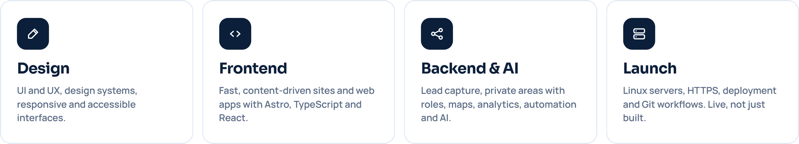

<picture>
  <source media="(prefers-color-scheme: dark)" srcset="assets/banner-dark.png">
  
</picture>

  &nbsp;
  &nbsp;
  &nbsp;
  

 

I take a project from idea to production: interface design, frontend, backend, integrations and deployment. I care about sites that look good, load fast and that the client can actually run day to day.

## What I do

<picture>
  <source media="(prefers-color-scheme: dark)" srcset="assets/areas-dark.png">
  
</picture>

 

## Selected work

<table>
  <tr>
    <td width="50%" valign="top">
       
      <b>infoPH · Real estate platform</b> 
      Public site and private area for a real estate company in Córdoba: listings with filters, map and search, landing pages for new developments, lead forms routed to the sales inbox, and a role-based private area for the sales team. Designed, built and deployed on its own server. 
      <code>Astro</code> <code>TypeScript</code> <code>Leaflet</code> <code>Linux</code>
    </td>
    <td width="50%" valign="top">
       
      <b>SHD Italia · Healthcare</b> 
      New website for an Italian company that builds modular systems for hospitals, presented to an international audience.
    </td>
  </tr>
  <tr>
    <td width="50%" valign="top">
       
      <b>ZEIT · Reebok Strength Argentina</b> 
      Website and SEO for the brand, plus a proposal for 3D product visualization.
    </td>
    <td width="50%" valign="top">
       
      <b>Operations platform · Logistics</b> 
      Routes, fleet management and an offline app for the team on the road.
    </td>
  </tr>
  <tr>
    <td width="50%" valign="top">
       
      <b>Jus Studio · E-commerce</b> 
      Shopify store, from design to checkout.
    </td>
    <td width="50%" valign="top">
       
      <b>Fidemza · Big Consulting · Starlings</b> 
      Product and interface design.
    </td>
  </tr>
</table>

 

## Stack

  
  
  
  
  
  
  
  
  
  

 

## Let's talk

Available for freelance projects and remote positions.

**[moyanogdev.com](https://moyanogdev.com)** · **gmoyanodvlpr@gmail.com** · [LinkedIn](https://www.linkedin.com/in/gonzalofedericomoyano/)

---

<strong>🇦🇷 En español</strong>

 

### Diseño, desarrollo y pongo en marcha productos digitales de punta a punta.

Desde el primer boceto hasta el sitio funcionando en su propio servidor. Vivo en Córdoba, Argentina, y trabajo de forma remota. Me ocupo de todo el recorrido: diseño de interfaz, frontend, backend, integraciones y publicación. Me importa que el sitio se vea bien, cargue rápido y que el cliente lo pueda usar en el día a día.

**Trabajos:** infoPH (plataforma inmobiliaria), SHD Italia (sistemas modulares hospitalarios), ZEIT – Reebok Strength Argentina (web y SEO), plataforma operativa de logística, Jus Studio (Shopify), Fidemza, Big Consulting y Starlings (diseño de producto).

**Disponible** para proyectos freelance y posiciones remotas · [moyanogdev.com](https://moyanogdev.com) · gmoyanodvlpr@gmail.com

