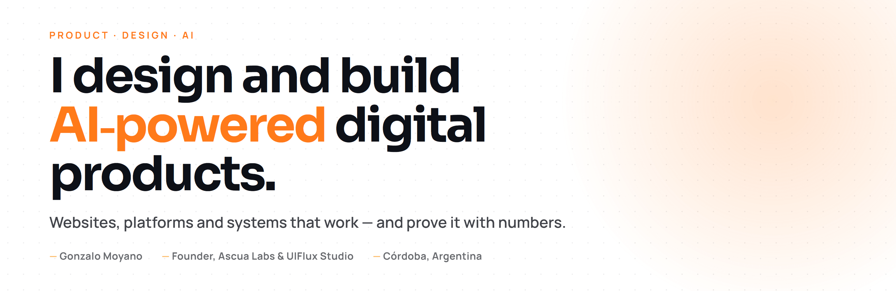
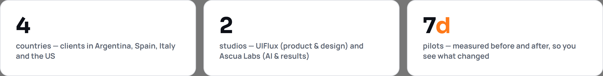
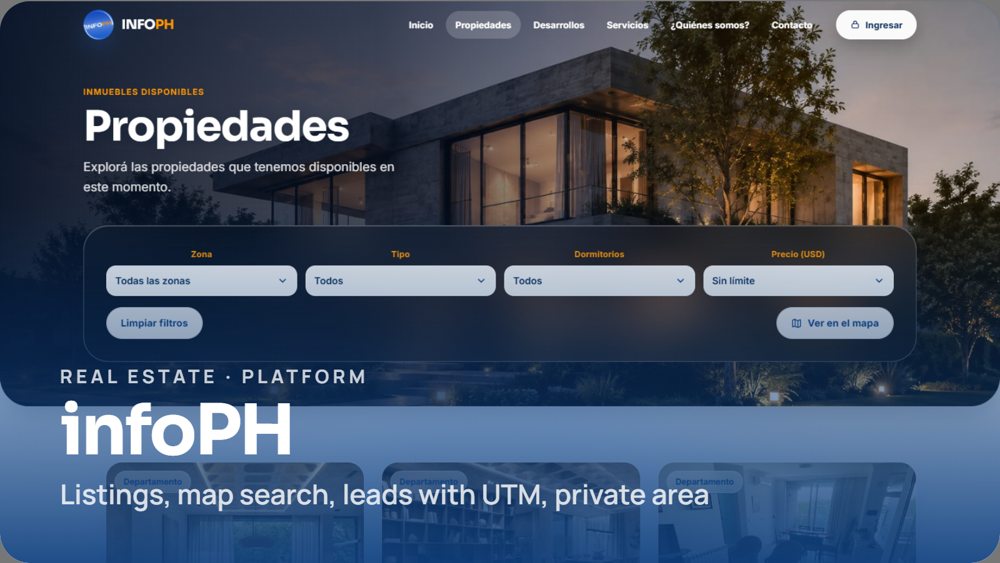
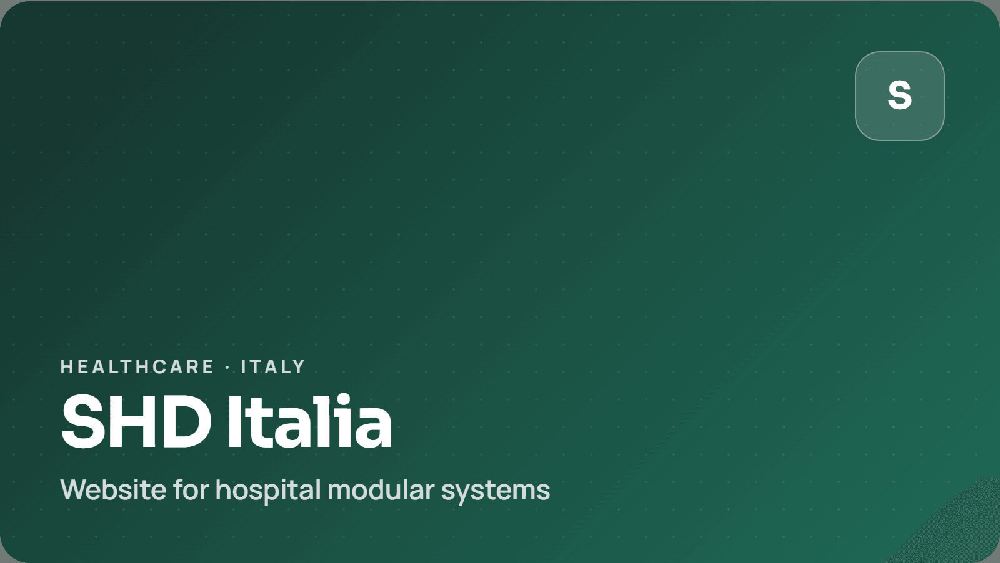
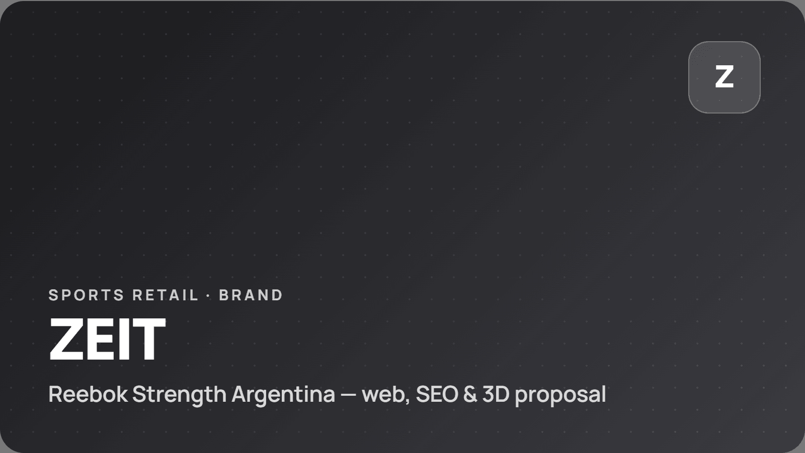
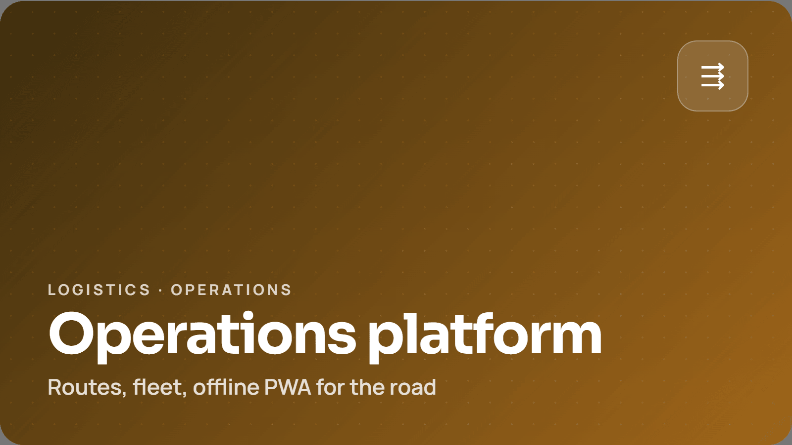
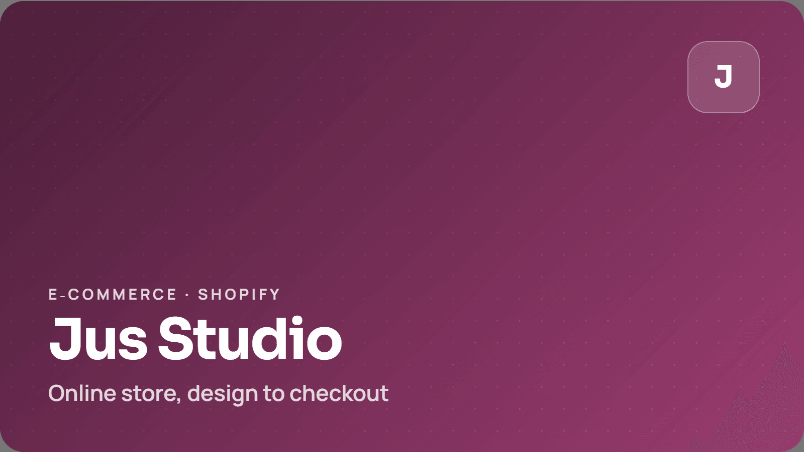
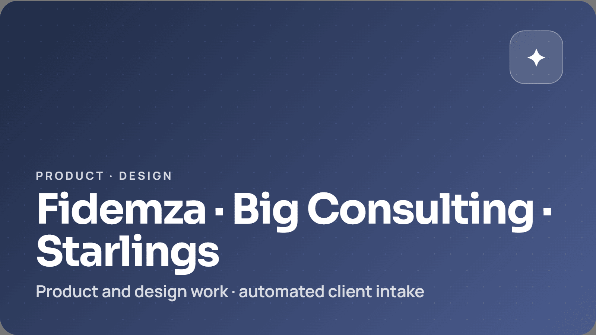
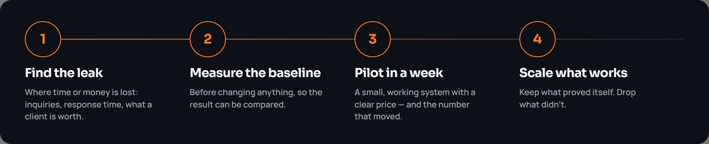

<picture>
  <source media="(prefers-color-scheme: dark)" srcset="assets/banner-dark.png">
  
</picture>

  &nbsp;
  &nbsp;
  

 

I turn ideas and day-to-day processes into digital systems that run on their own and can be measured. I design the experience your team and your customers use every day, and I build the technology behind it — including the AI and automation that does the repetitive work.

Founder of **Ascua Labs** (AI, automation and measurable results) and **UIFlux Studio** (product, design and interface). Working from Córdoba, Argentina, with clients in Argentina, Spain, Italy and the US.

<picture>
  <source media="(prefers-color-scheme: dark)" srcset="assets/facts-dark.png">
  
</picture>

 

## Selected work

<table>
  <tr>
    <td width="50%" valign="top">
       
      <b>infoPH · Real estate platform</b> &nbsp;<i>in progress</i> 
      A real estate company in Córdoba had its listings only on third-party classifieds. I built their platform: real listings with filters, map and search, landing pages for new developments, lead forms with campaign tracking routed to the sales inbox, and a role-based private area for the sales team. Running on its own server. Next: an AI agent that answers inquiries. 
      <code>Astro</code> <code>TypeScript</code> <code>Leaflet</code> <code>Linux</code> <code>Caddy</code>
    </td>
    <td width="50%" valign="top">
       
      <b>SHD Italia · Hospital modular systems</b> 
      New website for an Italian company that builds modular systems for hospitals: a technical, regulated industry presented to an international audience.
    </td>
  </tr>
  <tr>
    <td width="50%" valign="top">
       
      <b>ZEIT · Reebok Strength Argentina</b> 
      Website and SEO for the brand, plus a proposal for 3D product visualization and a richer commercial experience.
    </td>
    <td width="50%" valign="top">
       
      <b>Operations platform · Logistics</b> 
      Routes, fleet management and a PWA that works offline for the team on the road. A system, not a website.
    </td>
  </tr>
  <tr>
    <td width="50%" valign="top">
       
      <b>Jus Studio · E-commerce</b> 
      Shopify store, from design to checkout.
    </td>
    <td width="50%" valign="top">
       
      <b>Fidemza · Big Consulting · Starlings</b> 
      Product and design work. Fidemza: automated client intake <i>(in progress)</i>.
    </td>
  </tr>
</table>

 

## How I work

 

## Stack

  
  
  
  
  
  
  
  
  
  
  

 

## Let's talk

Open to new projects and remote roles. The first conversation is about where you lose time or money; the stack comes later.

**gmoyanodvlpr@gmail.com** · [LinkedIn](https://www.linkedin.com/in/gonzalofedericomoyano/)

---

<strong>🇦🇷 En español</strong>

 

### Diseño y desarrollo productos digitales con IA: webs, plataformas y sistemas que trabajan y se miden.

Fundador de **Ascua Labs** (IA, automatización y resultados medibles) y **UIFlux Studio** (producto, diseño e interfaz). Trabajo desde Córdoba con clientes de Argentina, España, Italia y Estados Unidos.

Convierto ideas y procesos en sistemas digitales que trabajan solos y se pueden medir. Diseño la experiencia que usan tu equipo y tus clientes todos los días, y construyo la tecnología que hay detrás, incluida la IA y la automatización que hace el trabajo repetitivo.

**Cómo trabajo:** miro dónde se te va tiempo o plata, mido el punto de partida, armo un piloto en una semana y te muestro el número que mejoró. Si funciona, seguimos.

**Casos:** infoPH (plataforma inmobiliaria), SHD Italia (sistemas modulares hospitalarios), ZEIT – Reebok Strength Argentina (web y SEO), plataforma operativa de logística (rutas, flota, PWA offline), Jus Studio (Shopify), Fidemza, Big Consulting y Starlings (producto y diseño).

**Hablemos:** gmoyanodvlpr@gmail.com

